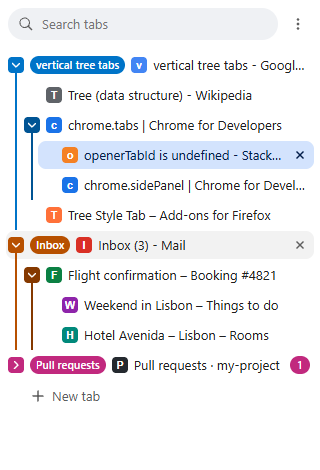
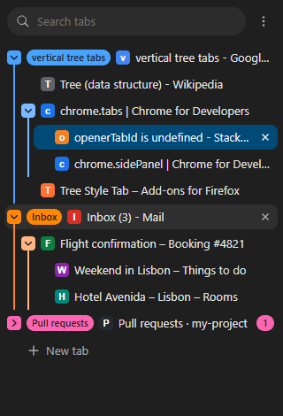

# Vertical Tree Tabs

A Chrome and Microsoft Edge extension that lists your tabs vertically in the side panel, as a
tree: every tab you open from a link sits under the tab you opened it from.

Search on Google and middle-click five results: the five tabs appear under the search tab.
Open links from one of those results and they appear under that result, one level deeper.
Each tree is also a tab group in the tab strip, in the tree's colour (see [Tab groups](#tab-groups)).

<p>
  
  
</p>

## Features

- **Tabs as a tree**, built as you browse: a tab opened from a link goes under the tab it came
  from ([How the tree is built](#how-the-tree-is-built)).
- **A colour for every tree**, with lighter and darker shades for the trees inside it; change it
  from the right-click menu ([Colours](#colours)).
- **Native tab groups** that mirror the trees, named after their top page, at the level you pick:
  one group per tree, per innermost subtree, per page or per branch, or none
  ([Tab groups](#tab-groups)).
- **Collapse and expand** trees; a collapsed tree shows how many tabs it hides, and collapses its
  tab group too.
- **Drag and drop** a tab with its subtree to rearrange it, nest it, or move it to another
  window; the real tabs move with it.
- **A right-click menu** for each tab: new tab as child, reload, duplicate, pin, mute, rename the
  tree's group, its colour, move to the top level or to a new window, close children, close the
  tree.
- **Search** that keeps each match's parents in view, and **keyboard** control of the whole
  tree ([Using the panel](#using-the-panel)).
- **Pinned tabs** as icons above the tree; a **speaker** on tabs that play sound, to mute them.
- **Light and dark** themes, following the browser.
- **Kept across restarts**: the tree, its colours, collapsed trees and group names come back
  after the extension reloads or the browser restarts ([What is kept, and where](#what-is-kept-and-where)).
- **Private**: everything stays in your browser; nothing is sent anywhere ([Privacy](PRIVACY.md)).

## Install

The extension is not in the browser stores yet; install it from this repository. It needs
Chrome 116 or later, or Microsoft Edge (tested with Edge 156 and 157).

1. **Get the code.** On this repository's page, click **Code → Download ZIP** and unzip it, or
   clone it:

   ```bash
   git clone https://github.com/oshri-almog/VerticalTreeTabs.git
   ```

2. **Open the extensions page.**
   - Chrome: go to `chrome://extensions` and turn on **Developer mode** (top right).
   - Edge: go to `edge://extensions` and turn on **Developer mode** (in the left-hand menu).
3. Click **Load unpacked** and choose the [`extension`](extension) folder inside the unzipped
   folder (the one that holds `manifest.json`).
4. **Pin it** (the puzzle-piece icon in the toolbar → pin), then click its icon, or press
   **Alt+T**, to open the panel. To change the shortcut, go to `chrome://extensions/shortcuts`
   (Edge: `edge://extensions/shortcuts`), or use **⋯ → Keyboard shortcut…** in the panel.
5. The browser asks to "read your browsing history" and to "view and manage your tab groups":
   see [Permissions](#permissions) for why.

Keep the folder where it is: the browser loads the extension from it each time.

**To update**, replace the folder's contents with the new version (download it again, or
`git pull`), then press the reload button on the extension's card on the extensions page. The
tree is kept.

**To remove it**, click **Remove** on its card on the extensions page; then you can delete the
folder.

## How the tree is built

- A tab opened **from a page** becomes a child of that page's tab: middle-click, Ctrl+click,
  a link that opens in a new tab, **Open link in new tab**, or `window.open`.
- Following a link **inside** a tab doesn't move it.
- Tabs that weren't opened from a page start at the top level: Ctrl+T, the New Tab button,
  bookmarks, Alt+Enter in the address bar. (Chrome reports the active tab as the "opener" of
  those too, so the extension listens for link-opened tabs specifically instead.)
- **Closing** a tab moves its children up one level, into its place. To close a whole tree,
  use **Close tree** in the right-click menu.
- **Pinned** tabs appear as icons above the tree and are not part of it; their children
  move up one level, into the pinned tab's place, until it is unpinned.
- Tabs already open when you install the extension start flat, since the browser can't say
  which tab opened them.

## Colours

Every tree gets a colour, like a tab group: the arrow of the tab at the top becomes a
coloured chip, and a line in that colour runs down beside the tabs in the tree. A tree inside
a tree is drawn in a lighter shade of the same colour, and the tree inside that in a lighter
one still (in the light theme: darker); deeper levels go back and forth between those two
shades. A single tab (a top-level tab without children) and a pinned tab have no colour.

- A new tree takes a colour that no other tree in the window has. There are eight; with more
  trees colours repeat, but a new one never takes the colour of the tree just above or below it.
- A tree keeps its colour while you rearrange it in its window, collapse or search, and after
  the extension reloads or the browser restarts. To change a tree's colour, right-click any
  tab in it and click a colour.
- Moved to another window, a tree keeps its colour unless a tree there already has it; then
  it takes another (with eight trees there already, it may keep its own).
- Close the tab at the top of a tree, or pin it, and its children move up into its place: the
  first subtree among them carries on in the tree's colour, and the others become trees with
  new colours. A subtree whose top tab headed a tree of its own before takes that colour back
  if it is free, and the next subtree carries on instead. With more than eight trees in the
  window, the colour goes to the first subtree that has no tree of that colour next to it, and
  the others take colours as new trees do, which can repeat those of trees further away, the
  tree's own included.
- A tab that stops heading a tree (its last child closed, it was pinned, or it was dragged
  into another tree) gets its colour back when it heads one again, unless another tree has
  taken it in the meantime.
- A colour only comes back or carries on if no other tree has it, or, in a window with more
  than eight trees, if neither tree next to it has it. So with up to eight trees, a colour you
  picked for two trees is not carried on when the top tab of one of them closes.

## Tab groups

Every tree is also a tab group in the browser's tab strip, in the tree's colour (the panel's
colours are the nine colours of tab groups). The group is named after the page at the top of the
tree, cut to its gist: "(2) Comedy · freshrss…" becomes "Comedy", "Inbox (3) - Mail" becomes
"Inbox". The name shows next to the tree's top tab in the panel.

- To rename a group, right-click any tab of its tree in the panel and type in the name field
  (Enter keeps the name, Esc doesn't), or right-click the group's name in the tab strip. An empty
  name brings back the automatic one.
- Colours go both ways: a colour picked in the panel colours the group, and one picked for the
  group in the tab strip colours the tree.
- Collapsing a tree in the panel collapses its group too, even the group of the tab you are on.
  If that tab is below the tree's top, you move to the top tab (as before); it stays the active
  tab, hidden in the tab strip. Collapsing or expanding the group in the tab strip does the same
  to the tree (Edge keeps you on your tab when you collapse its group: if it is below the top,
  you move to the top tab here too). The browser opens a collapsed group by itself when you
  switch to one of its tabs: the extension closes it again if the tree is still collapsed.
- Dragging a tab out of a group in the tab strip takes it out of its tree (its children move up
  into its place); dragging one into a group puts it into that group's tree, where it lands. Tabs
  taken out together stay together, out of the groups. "Ungroup" in the tab strip leaves the tree
  as it is, without a group, until you pick "Group in tab strip" in its right-click menu in the
  panel.
- A tree that ends (all but one of its tabs closed, say) loses its group, and a tree moved to
  another window gets its group there.

Settings (⋯ menu → Settings…):

- **One group per tree** (the default), **one group per innermost subtree**, **one group per
  page**, **one group per branch**, or **no groups**.
  An innermost subtree is a tab and the tabs opened from it, as long as none of those has tabs of
  its own: each gets a colour of its own, in the panel too, and its group breaks up once one of
  its tabs opens a tab. The tabs above such subtrees are in no group.
  With one group per page, a tab and the tabs opened from it share a group. When one of those
  opens a tab, it moves out of the group, to just after its end, and leads a new group with the
  tab it opened; the group it left stays. One group per branch does that for the tabs opened from
  a tree's top tab only: the new group then holds the tab, the first tab it opened and everything
  later opened inside that branch, and each further tab it opens starts a group of its own, right
  after the branch's group (the newest first). A tab you add under it yourself ("New tab as
  child", or one dropped under it in the panel) counts as one it opened: a further tab, unless it
  came first. In both, each group has a colour of its own, and the panel still shows every tab in
  its place in the tree.
- **Tab groups you made yourself**: **leave them alone** (the default), or **regroup them by
  tree**. Left alone, a tree with tabs in one of your groups gets no group, and one of your groups
  that holds exactly one tree becomes that tree's group, keeping its name and colour: the extension
  never ungroups it unless you ask (and when the tree ends, it is yours again, as it is). A tree
  dropped in the panel between two tabs of one of your groups lands just beside the group.

## Using the panel

| To | Do |
| --- | --- |
| Switch to a tab | Click it |
| Close a tab | Middle-click it, or click its × |
| Collapse or expand a tree | Click the arrow. A collapsed tree shows how many tabs it hides |
| Rearrange | Drag a tab with its subtree. Drop on the top edge of another tab to go before it, on the middle to become its child, on the bottom edge to go after it, or below the list to go to the end. Drag to another window's panel to move it there |
| Change a tree's colour | Right-click a tab in it and click a colour |
| Rename a tree's tab group | Right-click a tab in it and type in the name field |
| Mute a tab that plays sound | Click the speaker on its row |
| Everything else | Right-click: New tab as child, Reload, Duplicate, Pin, Mute, group name, tree colour, Ungroup/Group in tab strip, Collapse/Expand tree, Move to top level, Move tree to new window, Close children, Close tree, Close tab |
| Collapse or expand all | ⋯ menu at the top |
| Change the settings | ⋯ menu at the top → Settings… |
| Change the keyboard shortcut | ⋯ menu at the top → Keyboard shortcut… |
| Find a tab | Type in the search box: matches show with their parents. Enter switches to the first match, Esc clears |
| Use the keyboard | ↑ ↓ move, Home and End go to the first and last tab, ← → collapse/expand or go to the parent/child, Enter or Space switches, Delete closes, the Menu key opens the right-click menu |
| Open a tab | **New tab** under the list, or double-click the empty space |

Rearranging in the panel also moves the real tabs in the browser's tab strip, so both stay in
the same order. The active tab is always kept visible: switching to a tab inside a collapsed tree
expands it, and so does a drop that would put it inside one (other tabs dropped into a collapsed
tree are tucked away in it). A collapsed tree stays collapsed when you move it, to another window
too, unless it would hide the active tab there.

## What is kept, and where

- The tree survives the extension's background worker being shut down while idle.
- After the extension is reloaded or updated, the tree is restored by tab id.
- After a browser restart (with "Continue where you left off"), the tree is rebuilt from a
  snapshot. Chrome gives every restored tab a new id, so tabs are matched by URL, window by
  window; Edge keeps the ids, so they are matched by id. A tab that can't be matched starts at
  the top level, and the children of a tab the browser didn't restore move up to its parent.
- Tree colours are kept with the tree, and so is which trees are collapsed.
- Group names, and the trees you took out of the groups, are kept with the tree too. After a
  reload or a restart, the trees take their groups back.
- Everything stays in your browser profile (`chrome.storage`); nothing is sent anywhere. The
  snapshot holds the URLs of your open tabs, never those of incognito windows. See
  [PRIVACY.md](PRIVACY.md).

## Permissions

| Permission | What the browser calls it | Why the extension needs it |
| --- | --- | --- |
| `tabs` | Read your browsing history | To show each tab's title, icon and address in the panel, and to find tabs again by address after a browser restart |
| `webNavigation` | Read your browsing history | To learn which tab a link was opened from, which places a tab in the tree |
| `tabGroups` | View and manage your tab groups | To make each tree a tab group, and to follow the changes you make to groups |
| `sidePanel` | (none shown) | To show the tree in the browser's side panel |
| `storage` | (none shown) | To keep the tree, its colours and your settings in your browser profile |
| `favicon` | (none shown) | To show each site's icon in the panel |

The extension has no access to the content of the pages you visit, and makes no network
requests.

## Limitations

- Extensions can't hide the browser's horizontal tab strip, so the panel sits beside it.
- Each window's panel shows that window's tabs.
- The browser doesn't move tabs between a normal and an incognito window, so a tree dropped on
  the panel of the other kind of window stays where it is.
- Tab groups can't be nested: with one group per tree, a subtree is in its tree's group; with one
  group per innermost subtree, the tabs above those subtrees are in no group; with one group per
  page or per branch, a group comes right after the group of the tab that opened its first tab, so
  the tab strip shows the tree's levels one after another. Pinned tabs are in no group.
- The browser keeps every tab group in its list of saved groups, the extension's too (Chrome
  since version 133, Edge since 140). A tree's group leaves that list when the tree ends, but the
  groups of a window you close stay in the browser's Tab groups list, as yours do: delete them
  there.

## Development

```bash
npm install
```

```bash
npm test
```

runs the unit tests for the tree logic, the tab groups, the tree colours and their contrast in
both themes, and the restore after a restart (no browser needed).

```bash
npm run test:e2e
```

loads the extension into a headless Chromium and checks it the way a person would use it:
opening links in every way, collapsing, closing, dragging, the right-click menu, tree colours,
pinning, moving trees between windows, tab groups at every level, reloading the extension and
restarting the browser (`E2E_GROUPS=off` runs it with the tab groups off; the steps about groups
turn them on). It needs Chrome for Testing or Chromium, because branded Chrome no longer loads
unpacked extensions from the command line. It finds the copies that Puppeteer or Playwright
download. To use another build, Edge included, set `CHROME_PATH` to its executable. To get one:

```bash
npx @puppeteer/browsers install chrome@stable
```

`npm run icons` renders the PNG icons from [`extension/icons/icon.svg`](extension/icons/icon.svg),
and `npm run screenshots` regenerates the pictures above.

| Path | What it is |
| --- | --- |
| [`extension/`](extension) | The extension itself, the folder you load |
| [`extension/background.js`](extension/background.js) | Service worker: records which tab opened which, carries out moves and closes, keeps the tab groups in line, saves and restores the tree |
| [`extension/tree.js`](extension/tree.js) | Tree logic shared by the worker, the panel and the tests |
| [`extension/groups.js`](extension/groups.js) | Tab groups: which tabs share one, its name, colour and state, and the changes that make the browser's groups match |
| [`extension/restore.js`](extension/restore.js) | Rebuilding the tree from the saved snapshot |
| [`extension/sidepanel.html`](extension/sidepanel.html), [`.css`](extension/sidepanel.css), [`.js`](extension/sidepanel.js) | The panel |
| [`extension/options.html`](extension/options.html), [`.css`](extension/options.css), [`.js`](extension/options.js) | The settings page |
| [`test/`](test) | Unit tests, the end-to-end test and its browser harness |
| [`scripts/`](scripts) | Icon rendering, screenshots, locating a Chromium build |
| [`docs/PUBLISHING.md`](docs/PUBLISHING.md) | How to publish the extension on the Chrome Web Store and Microsoft Edge Add-ons |

## License

[MIT](LICENSE)
